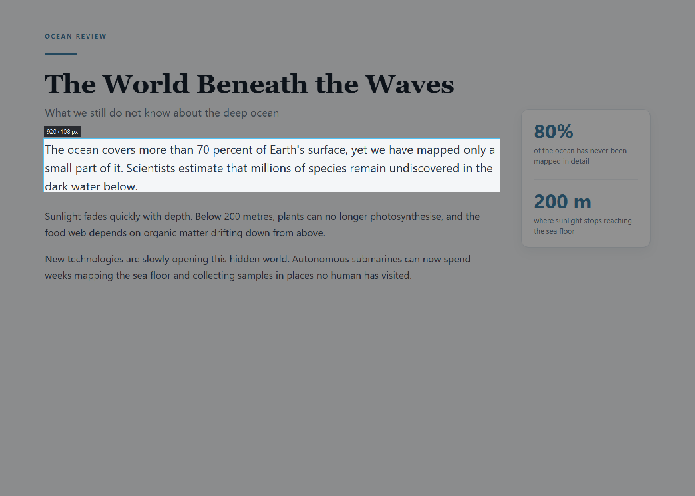
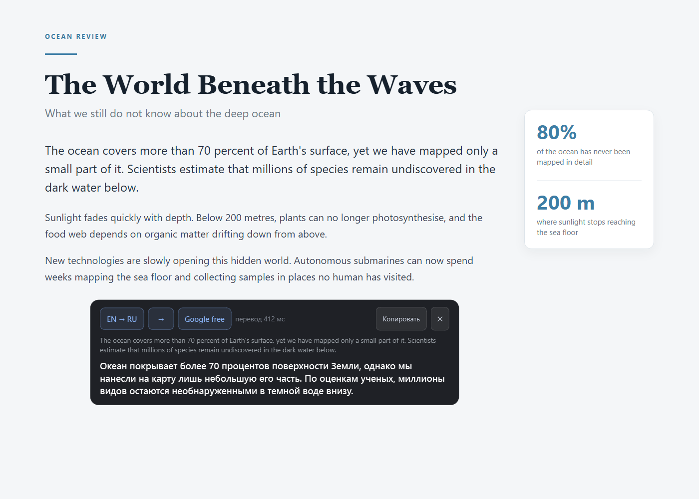
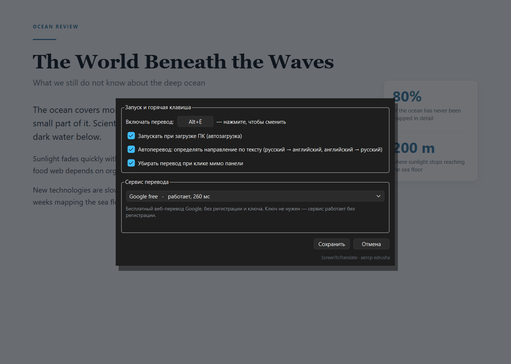

# ScreenToTranslate

Переводчик с экрана: обводишь область — рядом появляется перевод.
Работает на всех мониторах, включая HDR, и не требует установки отдельного
OCR-движка: используется Windows OCR.

## Скриншоты

Выделение области — экран затемняется, лишнее не отвлекает:



Панель перевода появляется рядом с выделением: язык, фактический сервис,
время перевода и сам текст.



Настройки: горячая клавиша, сервис перевода, ключи API и автозагрузка.



## Что умеет

- **Любой монитор.** Снимок всего виртуального экрана; оверлей и панель
  открываются на том мониторе, где находится курсор.
- **OCR на русском и английском.** Два движка (`ru` и `en`), выбор построчно;
  мелкий текст увеличивается, цветной не теряется, строки склеиваются в абзацы
  с учётом переносов и колонок.
- **Семь сервисов перевода.** Бесплатные Google free → Bing free → MyMemory free
  и API-сервисы Google, DeepL, Bing (Azure), Yandex — если введён ключ.
  Если сервис отказал, перевод делает следующий, а панель показывает причину.
- **Карантин и кэш.** Сервис с ошибкой 429 не трогается 30 минут, с прочими
  ошибками — 5 минут. Повторные переводы берутся из кэша мгновенно.
- **Панель с деталями.** Язык, фактический сервис, время перевода, пометка `⚠`
  при подмене сервиса и текст причины.
- **HDR-мониторы.** Захват через DXGI в линейном scRGB с пересчётом по уровню
  SDR-белого; обычный GDI-снимок остаётся запасным путём.
- **Настройки в трее.** Горячая клавиша, сервис и ключи, автозагрузка,
  поведение панели. Настройки и кэш хранятся в профиле пользователя.

## Скачать

Готовая portable-сборка лежит в [Releases](https://github.com/edrusha/ScreenToTranslate/releases/latest).

1. Скачайте `ScreenToTranslate-portable.zip`.
2. Распакуйте в любую папку, куда есть запись (не в `Program Files`).
3. Запустите `run.cmd`.

Python, pip и права администратора не нужны: внутри официальный Python 3.10
и все библиотеки. Настройки и кэш хранятся рядом с программой, папку можно
переносить целиком. `run_console.cmd` запускает то же самое с консолью — для
диагностики.

## Установка из исходников

Требования:

- Windows 10/11, 64-бит;
- Python 3.10–3.12, 64-бит (рекомендуется 3.10);
- языковые пакеты OCR `ru-ru` и `en-us` (см. раздел «Если что-то не работает»).

```
git clone https://github.com/edrusha/ScreenToTranslate.git
cd ScreenToTranslate
setup.cmd
run.cmd
```

`setup.cmd` ставит PySide6, Pillow и winsdk в профиль пользователя
(`%APPDATA%\Python\Python310\site-packages`). Права администратора не нужны.
Можно и без него: запустить `python st_app.py` и согласиться на автодокачку.
Папка `pylibs` в репозиторий не входит — это бинарные библиотеки, их место
в release-архиве, а не в git.

## Запуск и работа

Запуск: `run.cmd` в готовой сборке или `python st_app.py` из исходников.
В трее появляется значок «Ё». По умолчанию перевод включается по **Alt+Ё** —
так он не срабатывает, когда просто печатаешь текст. Экран затемнится, обведи
мышью текст → отпусти кнопку. Панель с переводом появится рядом с выделением.

| Действие | Клавиши |
|---|---|
| Выделить область | `Alt+Ё` (по умолчанию; режим меняется в настройках) |
| Повторить последнюю область | `Ctrl+Alt+Ё` или пункт в меню трея |
| Отмена выделения | `Esc` или правая кнопка мыши |
| Скопировать перевод | кнопка «Копировать» в панели или `Ctrl+C` при фокусе на панели |
| Закрыть панель | `Esc`, `✕` или клик мимо панели (можно выключить) |
| Выход | меню трея → «Выход» |

Режимы горячей клавиши: `Alt+Ё`, просто `Ё` и `Ctrl+Ё`. Если основной вариант
занят другой программой, приложение само пробует `Alt+Shift+Ё`, затем
`Ctrl+Alt+Ё`, и показывает предупреждение, если не удалось занять ни один.

### Что показывает панель

Сверху — чип языка (`EN → RU`), кнопка смены направления, чип сервиса и время
перевода.

- Чип сервиса — тот, который **фактически** перевёл. Если выбранный сервис
  не ответил, рядом появляется `⚠`, а под строкой — причина: «Google free:
  лимит запросов (429) — перевёл Bing free».
- Время: `перевод 713 мс` (только перевод, без OCR) или `из кэша`.
- Наведение на время показывает, сколько занял OCR.
- Смена языка или сервиса на чипе переводит тот же текст заново, без повторного
  выделения.

## Настройки

Меню трея → **Настройки…**:

- **Горячая клавиша** — режим `Alt+Ё`, `Ё` или `Ctrl+Ё` (кнопка «Изменить»);
- **Сервис перевода** — 7 сервисов. У бесплатных в подписи стоит «free»
  (Google free, Bing free, MyMemory free), у остальных — «api»: Google [api],
  Bing [api] (Azure Translator), DeepL [api], Yandex [api];
- при выборе сервиса, которому нужен ключ, появляется поле для ключа (и регион
  или folderId, если нужен) и кнопка **Проверить перевод** — она делает пробный
  перевод в фоне, не подвешивая окно;
- галочка «Убирать перевод при клике мимо панели»;
- галочка **Автозагрузка** — создаёт ярлык в папке «Автозагрузка» текущего
  пользователя.

Выбранный сервис сохраняется как основной (`engines.primary`), остальные
остаются запасными — если основной откажет, перевод всё равно получится.

### Проверка сервисов

Рядом с каждым сервисом показывается его настоящее состояние, а не пинг:

- `работает, 713 мс` — сервис действительно перевёл короткую фразу «Hello» → «ru»;
- `лимит запросов (429)`, `запрещено (403)`, `нет ответа` — что именно вернул
  сервис.

Это настоящий мини-перевод, поэтому видно реальную ситуацию: адрес может
пинговаться за 30 мс и при этом отдавать 429. Результат кэшируется на 2 минуты.
Ключевые сервисы при старте не проверяются: каждый их запрос стоит денег.

## Ключи API (необязательно)

Работает и без ключей. Если нужно лучшее качество:

1. **DeepL API Free** — бесплатный план, ключ вставляется в `engines.deepl`.
2. **Azure AI Translator, тир F0** — ключ в `engines.azure`, регион в
   `engines.azure_region`.
3. **Google Cloud Translation API** — ключ в `engines.google_api`.
4. **Yandex Translate API** — ключ в `engines.yandex`, folderId в
   `engines.yandex_folder`.

Ключ можно не писать в файл, а положить в переменную окружения `DEEPL_KEY` /
`AZURE_KEY` / `YANDEX_KEY`. Ключи не выводятся в чат и в логи.

## HDR-мониторы

Windows отдаёт HDR-рабочий стол в линейном scRGB, где 1.0 = 80 нит. Обычный
GDI-снимок из-за этого выглядит выбеленным: светлые участки сливаются, OCR
читает хуже, оверлей кажется засвеченным.

Что делает программа:

1. Определяет мониторы с включённым HDR и уровень SDR-белого.
2. Снимает такой монитор через DXGI (`DuplicateOutput1`, формат
   `R16G16B16A16_FLOAT`).
3. Пересчитывает линейный scRGB в sRGB с делением на SDR-белый.
4. Вставляет результат в общий снимок виртуального экрана — координаты и оверлей
   не меняются.

Если DXGI недоступен (нет прав, занят другим приложением, драйвер не
поддерживает), остаётся обычный GDI-снимок: программа работает как раньше,
просто с засветами.

Переменные для отладки:

| Переменная | Что делает |
|---|---|
| `ST_HDR=0` | полностью выключить HDR-путь, снимать только GDI |
| `ST_HDR_DEBUG=1` | печатать ошибки HDR-захвата в консоль |
| `ST_HDR_TRACE=1` | печатать шаги захвата (если приложение падает) |
| `ST_HDR_NUDGE=0` | не «толкать» вывод изображения перед кадром |

Диагностика без GUI: `python st_hdr.py` — покажет, какие мониторы HDR, их
SDR-белый и получится ли DXGI-кадр.

## Скорость и сеть

Перевод идёт по цепочке, первый удачный побеждает. Время складывается из захвата
и OCR (~0.2–0.4 с) и самого перевода.

- **Bing** — самый стабильный бесплатный вариант, но у него два шага: страница
  с токеном (~0.33 с) и запрос перевода (~0.7 с). Токен живёт 9 минут.
- Токен обновляется **только когда нужен**: по нажатию горячей клавиши,
  параллельно с выделением области. В простое приложение не делает запросов —
  фонового таймера нет.
- **Карантин.** Сервис с 429 не трогается 30 минут, с прочими ошибками — 5 минут.
- **При старте** один раз проверяется основной сервис: если он уже отдаёт 429,
  он сразу уходит в карантин, и первый перевод не ждёт его впустую.
- **Кэш** отдаёт повторный перевод за 0 мс.

## Файлы и настройки

| Что | Где |
|---|---|
| Настройки | `%APPDATA%\ScreenToTranslate\config.json` |
| Кэш переводов | `%LOCALAPPDATA%\ScreenToTranslate\cache\translations.json` |
| Лог автодокачки библиотек | `%LOCALAPPDATA%\ScreenToTranslate\bootstrap.log` |

Кэш маленький: около 350 байт на перевод, растёт медленно и только на новых
текстах. Если рядом с `st_app.py` положить свой `config.json`, программа
перейдёт в портативный режим и будет читать настройки из него. Переменные
`ST_CONFIG` и `ST_CACHE` позволяют задать пути явно.

Пример `config.json`:

```json
{
  "hotkey_mode": "alt",
  "target_lang": "auto",
  "ocr_languages": ["ru", "en"],
  "use_adaptive_ocr": false,
  "panel": {
    "font_size": 15,
    "width": 560,
    "opacity": 0.97,
    "hide_on_click_away": true
  },
  "engines": {
    "primary": "google_free",
    "order": ["google_free", "bing_free", "mymemory_free",
              "deepl_api", "bing_api", "yandex_api"],
    "deepl": "",
    "azure": "",
    "azure_region": "",
    "google_api": "",
    "yandex": "",
    "yandex_folder": "",
    "mymemory_email": ""
  }
}
```

- `hotkey_mode`: `alt`, `single` (одна клавиша `Ё`) или `ctrl`;
- `target_lang`: `auto` (латиница → ru, кириллица → en), `ru` или `en`;
- `ocr_languages`: порядок движков OCR;
- `use_adaptive_ocr`: `true` включает медленный вариант предобработки;
- `engines.primary`: выбранный сервис, остальные — запасные.

## Диагностика без мыши

```
python st_cli.py --monitor 1 --rect 0,0,900,300      # OCR+перевод прямоугольника
python st_cli.py --full --no-translate               # распознать весь экран
python st_hdr.py                                     # HDR-мониторы и DXGI-кадр
```

`st_cli.py` — диагностический инструмент, входит в релизный ZIP. В портативной
сборке запускайте его через `runtime\python.exe st_cli.py ...`.

## Если что-то не работает

> В портативной сборке Python лежит в `runtime\python.exe`. Везде ниже, где
> написано `python`, используйте `runtime\python.exe`.

### При запуске окно «Не хватает библиотек»

В портативной сборке такого окна быть не должно: библиотеки уже лежат в
`pylibs`, а pip внутри нет. Если оно появилось, ZIP распакован не целиком —
проверьте папки `pylibs` и `runtime` и запускайте `run.cmd`.

Если вы запускаете из исходников:

1. Нажмите **«Да»** — программа скачает PySide6, Pillow и winsdk (~250 МБ)
   в профиль пользователя. Это занимает 1–2 минуты, права администратора
   не нужны.
2. Если установка не удалась, посмотрите последние строки лога:
   `%LOCALAPPDATA%\ScreenToTranslate\bootstrap.log`.
3. Запустите `setup.cmd` из папки программы — он делает то же самое, но с
   видимой консолью и понятным выводом.
4. Проверьте вручную:

   ```
   python --version
   python -m pip --version
   python -m pip install --user -r requirements.txt
   ```

   Нужен Python **3.10–3.12, 64-бит**. На 3.13+ у `winsdk` пока нет колёс,
   поэтому установка завершится ошибкой.

Если пишет `No module named pip`:

```
python -m ensurepip --upgrade
```

Если мешает прокси или корпоративная сеть, настройте pip:

```
python -m pip config set global.proxy http://адрес:порт
```

или задайте переменные `HTTPS_PROXY` / `HTTP_PROXY`.

### `ModuleNotFoundError: No module named 'PySide6'` (или `PIL`, `winsdk`)

- Пакеты не установились или установились в другой Python. Запустите
  `setup.cmd` и убедитесь, что он видит Python 3.10–3.12.
- Если программа запускается ярлыком, проверьте путь в ярлыке:
  `%LOCALAPPDATA%\Programs\Python\Python310\pythonw.exe`.
- Если рядом с программой осталась старая папка `pylibs`, она имеет приоритет.
  Переименуйте или удалите её, чтобы использовались пакеты из профиля.
- После установки закройте и снова откройте программу.

### Программа не запускается, значка в трее нет

1. Запустите `run_console.cmd` — он оставит окно с текстом ошибки.
2. Проверьте, что Python на месте:
   `%LOCALAPPDATA%\Programs\Python\Python310\python.exe` (исходники) или
   `runtime\python.exe` (портативная сборка).
3. Посмотрите, не висит ли старый экземпляр: Диспетчер задач → `pythonw.exe`.
   Закройте его и запустите программу снова.
4. Если ошибка появляется после правки настроек, переименуйте `config.json`
   (рядом с программой в портативной сборке или
   `%APPDATA%\ScreenToTranslate\config.json` в установленной версии) в
   `config.json.bak` — программа создаст настройки по умолчанию.
5. Если подозреваете кэш, удалите `cache\translations.json` рядом с программой
   или `%LOCALAPPDATA%\ScreenToTranslate\cache\translations.json`.

### Горячая клавиша не срабатывает

- Другая программа уже заняла сочетание. Приложение пробует `Alt+Shift+Ё`,
  затем `Ctrl+Alt+Ё` и показывает предупреждение, если не удалось занять ничего.
- Смените режим в настройках: `Alt+Ё`, `Ё` или `Ctrl+Ё`.
- В играх с эксклюзивным полноэкранным режимом системные горячие клавиши могут
  не доходить. Переключите игру в оконный или безрамочный режим.
- На нестандартной раскладке клавиша `Ё` может отсутствовать. Выберите режим,
  который работает на вашей клавиатуре.

### OCR не распознаёт текст или переводит пустоту

1. Убедитесь, что установлены языковые пакеты OCR:
   **Параметры → Время и язык → Язык и регион → Русский / English (США) →
   Параметры языка → Распознавание текста (OCR)**.
   Для русского нужен пакет `ru-ru`, для английского — `en-us`.
2. Проверьте OCR без GUI:

   ```
   python st_cli.py --full --no-translate
   ```

   Если текст не распознаётся и здесь, проблема в языковых пакетах или качестве
   картинки, а не в переводе.
3. Мелкий текст: выделяйте область плотнее, программа увеличивает области
   ниже 160 px, но слишком мелкий шрифт всё равно может не читаться.
4. Цветной текст на пёстром фоне: включите `use_adaptive_ocr: true` в
   `config.json` (медленнее, но иногда точнее).
5. Защищённый контент (DRM, некоторые плееры и игры) Windows отдаёт чёрным
   кадром — это ограничение системы, обойти его нельзя.
6. На HDR-мониторе проверьте, не выбелен ли снимок: запустите `python st_hdr.py`
   и при необходимости временно поставьте `ST_HDR=0`.

### Перевод не идёт: 429, 403, «нет ответа»

- Откройте чип сервиса на панели: напротив каждого написано `работает, N мс`
  или причина отказа.
- **429** — лимит запросов по IP. Сервис уходит в карантин на 30 минут;
  подождите, выберите другой сервис или отключите VPN/WARP, который даёт общий
  IP. Для Google помогает исключить `googleapis.com`, `google.com`,
  `clients5.google.com` из туннеля.
- **403** — неверный ключ, регион или закончилась квота. Проверьте ключ и
  регион в настройках.
- **«нет ответа» у всех сервисов** — проблема в сети, DNS, прокси или фаерволе,
  а не в программе.
- Если выбранный сервис недоступен, перевод делает следующий по цепочке;
  панель покажет `⚠` и причину.
- Ключи API можно задать в настройках или переменными `DEEPL_KEY`,
  `AZURE_KEY`, `YANDEX_KEY`.

### Переводится не тот язык

- По умолчанию включён `auto`: латиница переводится на русский, кириллица — на
  английский.
- Смените направление чипом на панели или задайте `target_lang` в
  `config.json` (`ru` или `en`).
- Если в выделении смешаны языки, OCR может определить направление неверно.
  Выделяйте только нужный фрагмент.

### Панель не закрывается или мешает

- `Esc`, кнопка `✕` или клик мимо панели.
- Клик мимо можно отключить галочкой «Убирать перевод при клике мимо панели».
- Размер, шрифт и прозрачность панели задаются в `config.json`:
  `panel.font_size`, `panel.width`, `panel.opacity`.

### Настройки не сохраняются

- Программа пишет настройки в `%APPDATA%\ScreenToTranslate\config.json`.
  Проверьте, что у пользователя есть права на запись в `%APPDATA%`.
- Если рядом с программой лежит `config.json`, включён портативный режим.
  В `Program Files` этот файл доступен только для чтения — уберите его или
  перенесите программу в папку пользователя.
- Ошибка сохранения показывается отдельным окном.

### Автозагрузка не работает

- Галочка в настройках создаёт ярлык в
  `%APPDATA%\Microsoft\Windows\Start Menu\Programs\Startup`.
- Проверьте, что ярлык там есть и ведёт на существующий `pythonw.exe`
  и `st_app.py`.
- Антивирус или политика системы могут блокировать автозагрузку — добавьте
  программу в исключения.

### HDR выглядит выбеленным

- Запустите `python st_hdr.py` — он покажет, видит ли программа HDR-монитор
  и получается ли DXGI-кадр.
- Запустите `run_console.cmd` с `ST_HDR_DEBUG=1`, чтобы увидеть причину отказа.
- Временно проверьте с `ST_HDR=0`: если с GDI лучше, проблема в HDR-захвате
  (драйвер, занятость DXGI или защита контента).

### Антивирус ругается на автодокачку

Программа не скачивает сторонние exe и не ставит ничего молча: она показывает
окно, а по согласию запускает стандартный `python -m pip install` с PyPI.
Если антивирус всё равно блокирует:

- запустите `setup.cmd` вручную — установка будет видна в консоли;
- добавьте в исключения папки Python и `%APPDATA%\Python`;
- не отключайте антивирус полностью.

### Где посмотреть ошибку

- `run_console.cmd` — запуск с консолью, traceback остаётся на экране;
- `%LOCALAPPDATA%\ScreenToTranslate\bootstrap.log` — лог установки библиотек;
- `python st_cli.py ...` и `python st_hdr.py ...` — диагностика OCR, перевода
  и HDR; в портативной сборке — `runtime\python.exe st_cli.py ...` и
  `runtime\python.exe st_hdr.py ...`.

При сообщении об ошибке приложите версию Windows, версию Python (`python --version`),
текст из консоли и `config.json` **без ключей API**.

## Известные ограничения

- Защищённый контент (DRM) захватывается чёрным кадром — ограничение Windows.
- Эксклюзивный полноэкранный режим некоторых игр может блокировать оверлей
  и горячие клавиши.
- Для OCR нужны языковые пакеты Windows; без них распознавание не работает.
- Python 3.13 и новее пока не поддерживаются из-за `winsdk` (нужен 3.10–3.12).
- Перевод выполняется по выделению, а не непрерывно за курсором.
- Озвучки перевода нет.

## Состав папки

| Файл | Роль |
|---|---|
| `st_capture.py` | захват всех мониторов (GDI), DPI v2, перечисление мониторов |
| `st_hdr.py` | HDR-мониторы: DXGI-захват, пересчёт scRGB → sRGB, диагностика |
| `st_ocr.py` | Windows OCR: два движка, варианты предобработки, абзацы из строк |
| `st_translate.py` | движки перевода, нарезка текста, кэш, карантин, проверка сервисов |
| `st_config.py` | настройки в `%APPDATA%` и переменные окружения |
| `st_app.py` | GUI: трей, горячие клавиши, оверлей выделения, панель, настройки |
| `st_bootstrap.py` | проверка зависимостей и установка через `pip --user` |
| `st_cli.py` | конвейер без GUI (диагностика) |
| `requirements.txt` | версии PySide6, Pillow и winsdk |
| `setup.cmd` | установка зависимостей в профиль пользователя |
| `run.cmd`, `run_console.cmd` | запуск без консоли / с консолью |
| `docs/` | скриншоты для README |
| `pylibs/` | библиотеки для portable-сборки; в git не входит |
| `runtime/` | Python 3.10 для portable-сборки; в git не входит |

`runtime/` и `pylibs/` есть только в готовом ZIP из Releases. В репозитории
лежат исходники, `requirements.txt` и `setup.cmd`.

## Автор

[edrusha](https://github.com/edrusha)
